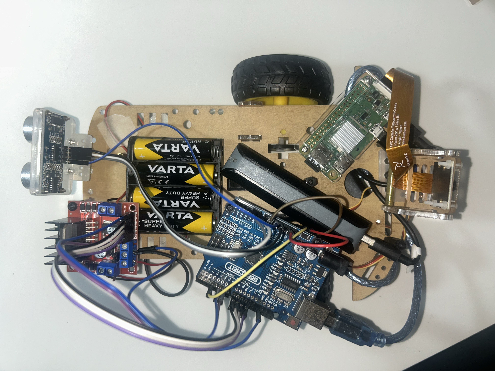

# kARt — FPV robotic kart in Mixed Reality

Project for the **Lab of IoT** exam — University of Salerno, A.Y. 2026/2027.

A robotic kart driven in real time from a **Meta Quest 3S** in Mixed Reality. Thanks to passthrough the pilot keeps seeing the real room, with a first-person (FPV) video panel from the onboard camera and a telemetry HUD in front of them. Passthrough can be turned off to drive fully immersed in a virtual environment. The system follows the three-layer IoT architecture:

| Layer | Node | Role |
| :--- | :--- | :--- |
| **Sensor / Actuation** | Arduino Uno R3 | Motors (L298N), HC-SR04 reverse sensor, camera servo, watchdog and automatic braking |
| **Gateway** | Raspberry Pi Zero W | UDP ↔ serial bridge, Mosquitto MQTT broker, camera streaming |
| **Application** | Meta Quest 3S (Unity) + Node-RED | Driving with the controllers, FPV panel, HUD, monitoring dashboard |

Driving runs over **UDP** (30 Hz, low latency), the video over **HTTP** (MJPEG), and telemetry, events and configuration over **MQTT**.

| Port | Protocol | Use |
| :--- | :--- | :--- |
| 5005 / 5006 | UDP | Commands Quest → Pi / telemetry Pi → Quest |
| 8080 | HTTP | MJPEG video stream (`/stream.mjpg`) |
| 1883 | MQTT | Mosquitto broker on the Pi (`arkart/#` topics) |

📄 Full project document (in Italian): [project.md](project.md)

## Demo

[](media/kart-demo.mp4)

▶️ [Watch the demo video](media/kart-demo.mp4)

## Repository structure

```
├── project.md                  # project document (architecture, protocol, measurements, decisions)
├── IoT Lab-...-kARt-EN.key     # presentation (Keynote, stored with Git LFS)
├── media/                      # demo video and screenshots
└── code/
    ├── arduino/
    │   ├── arkart_firmware/    # kart firmware
    │   └── test_*/             # test sketches for motors, sensor and servo
    ├── pi/                     # Python bridge, MJPEG camera streaming, systemd services, MQTT broker, automatic setup
    ├── kARt/                   # Unity 6 project for Meta Quest 3S
    ├── nodered/                # Node-RED dashboard (flows.json)
    └── tools/                  # keyboard driving console, Pi and Node-RED admin console
```

## Getting started

**Arduino** — upload `code/arduino/arkart_firmware/arkart_firmware.ino` with the Arduino IDE (only built-in libraries are used).

**Raspberry Pi** — flash the microSD with Raspberry Pi OS Lite (32-bit) using Raspberry Pi Imager, enabling SSH and Wi-Fi, then from the `code/pi` folder:

```bash
ssh <user>@<pi> 'mkdir -p ~/arkart'
scp arkart_bridge.py arkart-bridge.service arkart_camera.py arkart-camera.service mosquitto-arkart.conf setup_pi.sh <user>@<pi>:~/arkart/
ssh -t <user>@<pi> 'bash ~/arkart/setup_pi.sh'
```

The script installs the packages and sets up the MQTT broker, the bridge and the camera stream as services started at boot. It also enables the driver for the IMX219 camera, so reboot the Pi once it is done.

**Quest** — open `code/kARt` with Unity 6 (Android module) and set the Pi's IP address in the `KartLink` component. Then, from the **kARt** menu: *1* creates the interface, *2* configures the project for the Quest, *4* builds the app and installs it on the headset.

| Control | Action |
| :--- | :--- |
| Right / left trigger | Throttle / reverse |
| Left stick | Steering |
| Right stick (click: re-center) | Camera pan |
| B | Emergency stop |
| X | Passthrough on / off |

**Node-RED** — on a laptop on the same network as the Pi:

```bash
cd code/nodered
npm install
npm start
```

The dashboard is at `http://localhost:1880/dashboard/kart` and connects to the broker on the Pi.

**Test without the headset** — from a computer on the same network as the Pi:

```bash
cd code/tools
python3 -m venv .venv && .venv/bin/pip install pyserial
.venv/bin/python kart_console.py --udp <pi-address>
```

**Managing the Pi and Node-RED** — a small menu to check the Pi's services, read their logs, grab a camera snapshot, reboot or shut down the Pi, and start or stop Node-RED:

```bash
python3 code/tools/kart_admin.py --host <ssh-host>
```

## Author

**Enrico Madonna** — University of Salerno
