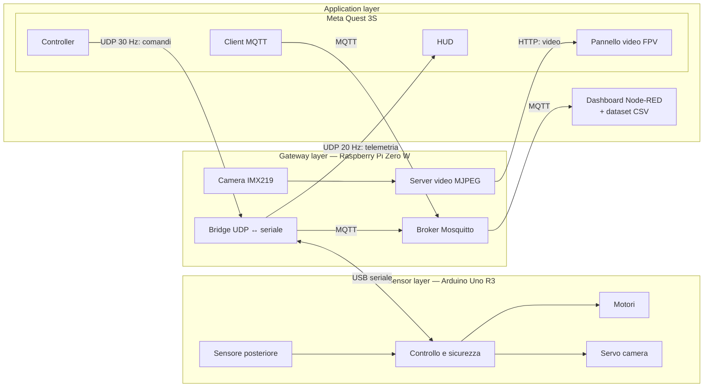

# kARt — Kart robotico FPV in Mixed Reality

**Lab of IoT — Università degli Studi di Salerno — A.A. 2026/2027**

kARt è un piccolo kart robotico che si guida indossando un **Meta Quest 3S**. Davanti al pilota compare uno schermo virtuale con il video in diretta dalla camera di bordo, come se fosse seduto al posto di guida; intorno, grazie al passthrough, continua a vedere la stanza reale e il kart stesso. Chi preferisce l'immersione totale può spegnere il passthrough con un tasto e ritrovarsi in un ambiente virtuale.

Dietro c'è un sistema IoT a tre livelli: un **Arduino** a bordo comanda motori, sensore e camera, una **Raspberry Pi** fa da ponte verso il Wi-Fi e trasmette il video, e il **Quest** insieme a una dashboard **Node-RED** sono le applicazioni che guidano e controllano il kart.

---

## 1. Cosa deve fare

| | Requisito | Come lo verifichiamo |
| :--- | :--- | :--- |
| R1 | Guidare il kart dai controller del Quest | Comandi inviati 30 volte al secondo, risposta immediata |
| R2 | Vedere nel visore il video della camera di bordo | Almeno 20 FPS, latenza misurata |
| R3 | Restare in contatto con la stanza reale | Passthrough attivo, pannello video fisso nello spazio |
| R4 | Fermarsi da solo se si perde il collegamento | Stop entro 300 ms dall'ultimo comando |
| R5 | Non urtare quando va in retromarcia | Rallenta sotto 30 cm, si ferma sotto 15 cm |
| R6 | Girare la camera per guardarsi intorno | ±45°, con ritorno al centro |
| R7 | Essere monitorato come un nodo IoT | Telemetria ed eventi su MQTT, dashboard con grafici e dataset |

---

## 2. Architettura

| Livello | Nodo | Cosa fa |
| :--- | :--- | :--- |
| **Sensor / Actuation** | Arduino Uno R3 | Motori, sensore di retromarcia, servo della camera, sicurezza |
| **Gateway** | Raspberry Pi Zero W | Ponte Wi-Fi ↔ Arduino, streaming della camera, broker MQTT |
| **Application** | Meta Quest 3S (Unity) | Guida, video FPV, HUD |
| | Node-RED (portatile) | Dashboard, configurazione remota, dataset CSV |

Il kart usa **due canali, perché hanno esigenze opposte**:

* **UDP per la guida.** I comandi devono arrivare subito: un pacchetto perso non va ritrasmesso, perché dopo 33 ms ne arriva già uno nuovo. Niente broker in mezzo, latenza minima.
* **MQTT per il monitoraggio.** Telemetria, eventi e stato dei nodi interessano a più ascoltatori (dashboard, visore) e non hanno fretta. Il modello publish/subscribe permette di aggiungerne altri senza toccare il kart, e il Last Will segnala da solo quando un nodo cade.

La guida non dipende da MQTT: se il broker o il portatile non rispondono, il kart continua a funzionare.



Quest, Pi e portatile stanno sulla stessa rete Wi-Fi a 2.4 GHz (l'unica supportata dalla Pi Zero W). L'indirizzo della Pi si imposta nell'app con un IP numerico: su Android i nomi `.local` non sono affidabili.

---

## 3. Come comunicano

### 3.1 Comandi e telemetria
I messaggi di guida sono righe di testo, leggibili anche a occhio durante il debug:

```
C,<seq>,<throttle>,<steer>,<pan>      comando, Quest → Pi → Arduino, 30 Hz
T,<seq>,<distanza_cm>,<stato>         telemetria, Arduino → Pi → Quest, 20 Hz
```

* `throttle` e `steer` vanno da −255 a +255, `pan` è l'angolo della camera da −45° a +45°.
* Ogni comando ha un **numero di sequenza**: la Pi scarta i pacchetti vecchi o duplicati, e la telemetria riporta l'ultimo numero ricevuto, così il Quest misura il tempo di andata e ritorno (RTT) dell'intero giro.
* `stato` può essere `OK`, `WARN` (ostacolo vicino in retromarcia), `STOP` (frenata), `FAILSAFE` (comandi interrotti) o `BOOT`.
* La configurazione arriva all'Arduino come `P,<velocità_max>,<soglia_frenata_cm>`.

### 3.2 Topic MQTT
Il broker gira sulla Pi, l'unico nodo sempre acceso. I messaggi sono JSON.

| Topic | Chi pubblica | Contenuto |
| :--- | :--- | :--- |
| `arkart/kart/telemetry` | Pi, 2 Hz | Distanza, stato, comandi, segnale Wi-Fi, temperatura CPU |
| `arkart/kart/events` | Pi | `COLLISION_PREVENTED`, `FAILSAFE` |
| `arkart/kart/status` | Pi | `online` / `offline` (Last Will) |
| `arkart/quest/metrics` | Quest, 1 Hz | RTT, FPS del video, comandi persi, batteria del visore |
| `arkart/quest/status` | Quest | `online` / `offline` (Last Will) |
| `arkart/config` | Node-RED | Velocità massima e soglia di frenata |

Per "comandi persi" il Quest conta i comandi che nessuna telemetria conferma entro 500 ms.

### 3.3 Video
Il video viaggia separato, in **MJPEG su HTTP**: la Pi codifica ogni fotogramma in JPEG con l'encoder hardware e lo spedisce come flusso continuo; il Quest lo decodifica e lo mostra sul pannello. È la soluzione più semplice che regga su una Pi Zero, senza buffering e senza librerie esterne. Su una scheda più potente, H.264 via WebRTC darebbe più qualità con meno banda.

---

## 4. Il kart — Arduino Uno R3

### 4.1 Hardware
Car kit 2WD: telaio in plexiglass, due motoriduttori TT, ruotino folle, driver **L298N**, portabatterie 4×AA. Il sensore a ultrasuoni **HC-SR04** è montato dietro, fisso, come sensore di retromarcia; il servo **SG90** sta davanti e porta la camera.

| Funzione | Pin |
| :--- | :--- |
| Motore destro: ENA (PWM), IN1, IN2 | D6, D11, D10 |
| Motore sinistro: ENB (PWM), IN3, IN4 | D5, D9, D8 |
| HC-SR04 Trig / Echo | A0 / A1 |
| Servo della camera | D3 |

Sull'L298N vanno tolti i jumper ENA ed ENB, altrimenti i motori girano sempre al massimo. Il motore sinistro è montato a specchio, quindi il firmware ne inverte il verso.

### 4.2 Come si muove
* **Sterzo differenziale**: la ruota sinistra riceve `throttle + steer`, la destra `throttle − steer`. Con acceleratore a zero e sterzo al massimo il kart gira su se stesso.
* **Sensore**: una lettura ogni 50 ms, con la mediana delle ultime tre per eliminare i valori anomali. Oltre circa 2 m il sensore non vede nulla e la strada risulta libera.
* **Camera**: il servo segue lo stick con una rampa (al massimo 300°/s), per non dare scossoni all'immagine.

### 4.3 Sicurezza, su tre livelli
1. **Watchdog dei comandi**: se per 300 ms non arriva un comando valido, i motori si fermano (`FAILSAFE`). Il kart riparte solo dopo un comando con acceleratore a zero, così non scatta in avanti da solo quando il collegamento torna.
2. **Frenata in retromarcia**: sotto 30 cm la retromarcia rallenta, sotto 15 cm si blocca. La marcia avanti resta sempre possibile, per potersi allontanare. Un'isteresi di 3 cm evita che lo stato oscilli al limite della soglia.
3. **Watchdog hardware**: se il firmware si blocca, dopo 500 ms l'Arduino si riavvia con i motori spenti.

A questi si aggiunge un quarto controllo sulla Pi, che ferma i motori dopo 250 ms senza comandi dal visore.

---

## 5. Il gateway — Raspberry Pi Zero W

Sulla Pi girano tre servizi, avviati automaticamente all'accensione:

* **Bridge** (`arkart_bridge.py`): riceve i comandi UDP, li controlla e li passa all'Arduino sulla USB; rimanda la telemetria al visore e la pubblica su MQTT, insieme a segnale Wi-Fi e temperatura della CPU. Inoltra all'Arduino la configurazione che arriva da Node-RED.
* **Streaming della camera** (`arkart_camera.py`): 640×480 a 30 FPS in MJPEG, su `http://<pi>:8080/stream.mjpg`. È un servizio separato dal bridge: se la camera si blocca, si continua a guidare.
* **Broker Mosquitto** sulla porta 1883.

La camera è una **Freenove 8MP (IMX219, 120°)**, collegata con il cavo flat per Pi Zero (22→15 pin). Non viene riconosciuta in automatico, quindi in `config.txt` si forza il driver con `dtoverlay=imx219`.

Tutta l'installazione è automatica con `code/pi/setup_pi.sh`: la scheda si può rifare da zero in pochi minuti.

---

## 6. L'app per il Quest

L'app è costruita sul modello "Mixed Reality" di Unity 6 (OpenXR, AR Foundation per il passthrough, XR Interaction Toolkit per i controller).

### 6.1 Comandi
I comandi seguono lo schema dei giochi di guida, con acceleratore e sterzo su dita diverse:

| Comando | Azione |
| :--- | :--- |
| Grilletto destro / sinistro | Acceleratore / retromarcia, in modo proporzionale |
| Stick sinistro | Sterzo |
| Stick destro | Gira la camera; con un click torna al centro |
| B | Stop di emergenza (di nuovo B per ripartire) |
| X | Passthrough acceso / spento |

Lasciando i grilletti il kart si ferma. L'acceleratore ha una curva progressiva, per avere più controllo alle basse velocità.

### 6.2 Cosa vede il pilota
* **Pannello video** fisso nello spazio, circa 2 m davanti: non segue la testa, quindi guardandosi intorno si vede la stanza. Un'etichetta indica se il video è in diretta e a quanti FPS.
* **HUD** più in basso, inclinato verso il pilota: stato del kart, barre di acceleratore, sterzo e camera, distanza dall'ostacolo dietro con una barra a colori come i sensori di parcheggio delle auto, RTT, pacchetti e stato del collegamento MQTT.
* **Passthrough** acceso di default: la stanza reale fa da riferimento e riduce molto la nausea rispetto a un FPV in realtà virtuale. Spegnendolo con X, la stanza viene coperta da un cielo e da un pavimento a griglia, all'altezza di quello vero.

### 6.3 Il Quest come nodo IoT
L'app pubblica il proprio stato e le metriche del collegamento sul broker della Pi, così il visore compare nella dashboard come gli altri nodi. Il client MQTT è scritto nel progetto: una libreria esterna come MQTTnet su Android dà spesso problemi con la compilazione IL2CPP, e per pubblicare pochi messaggi basta molto meno.

---

## 7. La dashboard Node-RED

Node-RED gira su un portatile collegato alla stessa rete e si iscrive a tutti i topic `arkart/#`. Non sta sulla Pi perché la Zero è già impegnata dal video.

La dashboard mostra:
* lo **stato del kart** a parole e i nodi online (kart e visore);
* la **distanza dall'ostacolo** posteriore, anche nel tempo, con le soglie di rallentamento e frenata;
* la **qualità del collegamento** dal Quest: RTT, FPS, comandi persi, batteria del visore;
* lo **stato della Pi**: temperatura, segnale Wi-Fi, tempo di accensione;
* il **registro degli eventi** (frenate automatiche e fail-safe), con un avviso sonoro attivabile;
* due cursori per cambiare da remoto **velocità massima e soglia di frenata**.

È anche l'unico nodo che **salva i dati**: telemetria ed eventi finiscono in due file CSV, usati per le misure.

---

## 8. Alimentazione

Logica e motori hanno due alimentazioni separate, perché gli spunti dei motori possono far riavviare la Pi:

* **Power bank USB 5 V** per Pi, Arduino (alimentato dalla Pi via USB), sensore e servo.
* **4 pile AA** per l'L298N e i motori, con la massa in comune con l'Arduino.


---

## 9. Misure

| Misura | Come |
| :--- | :--- |
| Latenza del video | La camera inquadra un cronometro; si fotografano insieme schermo e visore e si confrontano i tempi |
| RTT dei comandi | Dal numero di sequenza, misurato dal Quest |
| Comandi persi | Dalle metriche del Quest, a diverse distanze dal router |
| Intervento del fail-safe | Si interrompe il collegamento in marcia e si misura il tempo allo stop |
| Frenata in retromarcia | Retromarcia verso un muro a varie velocità, distanza finale misurata |

 