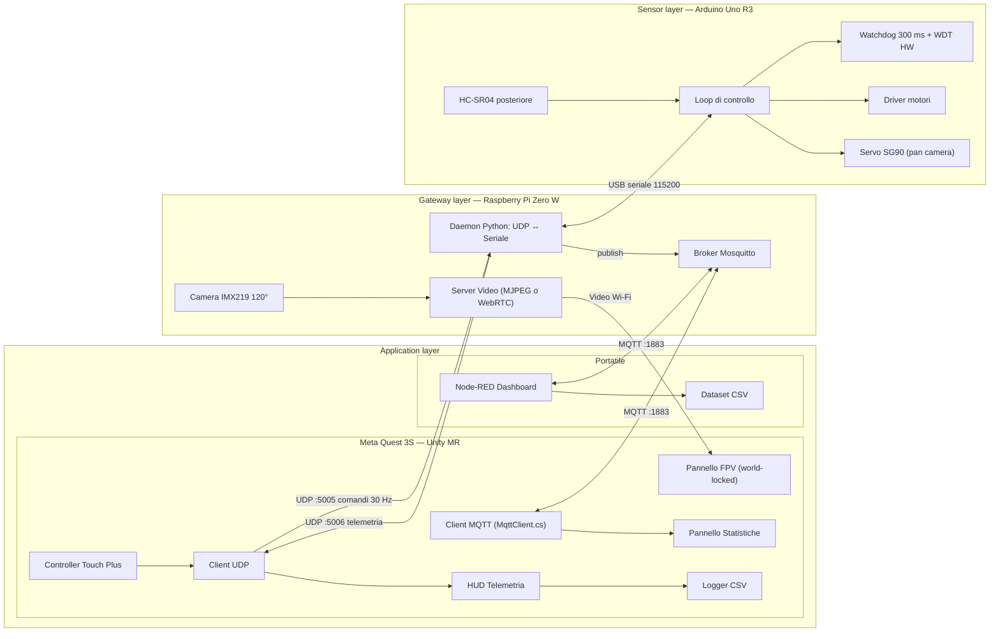

# kARt — Kart robotico FPV in Mixed Reality

**Lab of IoT — Università degli Studi di Salerno — A.A. 2026/2027** · Prof. Massimo Ficco

Kart robotico guidato in tempo reale da un **Meta Quest 3S** in **Mixed Reality**: tramite il passthrough il pilota continua a vedere la stanza reale (e il kart), mentre davanti a lui compaiono un **pannello video FPV** con la camera di bordo, un **HUD di telemetria** e un **pannello statistiche**. Il sistema segue l'architettura IoT a tre livelli (**Sensor → Gateway → Application**): Arduino Uno R3 a bordo, Raspberry Pi Zero W come gateway, Quest 3S e dashboard **Node-RED** come applicazioni. Gli scambi avvengono via **UDP** (guida real-time) e **MQTT** (monitoraggio). Il kart ha un watchdog sui comandi, un sensore di retromarcia con frenata automatica e una camera orientabile su servo.

> **Stato documento**: v3.3 (14/10/2026), allineato agli standard dei progetti del corso ([Educational Projects](https://iotresearch.cs.unisa.it/edu_projects.html)). Le voci marcate **[TBD]** vanno verificate quando arriva l'hardware o dopo i benchmark.

---

## 1. Scenario e obiettivi

**Scenario.** Telepresenza robotica: un operatore pilota un veicolo remoto vedendo attraverso i suoi "occhi" (camera di bordo), senza perdere il contatto con l'ambiente in cui si trova (passthrough MR). Lo stesso paradigma si applica a ispezioni in spazi angusti, logistica di magazzino e robot di sorveglianza. Il veicolo è un nodo IoT: pubblica telemetria ed eventi, riceve configurazione da remoto ed è monitorato da una dashboard.

| ID | Requisito | Criterio di accettazione |
| :--- | :--- | :--- |
| R1 | Guida remota del kart dai controller Touch del Quest | Comandi a 30 Hz, risposta percepita immediata |
| R2 | Video FPV dalla camera di bordo, visibile nel visore | ≥ 20 FPS, latenza misurata e riportata (obiettivo < 250 ms) |
| R3 | Esperienza MR con passthrough attivo | Stanza reale sempre visibile, pannello FPV fisso nello spazio (non legato alla testa) |
| R4 | Il kart si ferma se perde il collegamento | Stop entro 300 ms dall'ultimo comando valido |
| R5 | Sensore di retromarcia con frenata automatica | Bip di parcheggio nell'HUD, stop in retromarcia sotto 15 cm, marcia avanti sempre consentita |
| R5b | Camera orientabile | Servo pan ±45° comandato dallo stick destro, ritorno al centro con un click |
| R6 | Telemetria, eventi e configurazione su MQTT | Topic documentati, stato online/offline via LWT, comandi di configurazione bidirezionali |
| R7 | Dashboard di monitoraggio | Node-RED: gauge, grafici, log eventi, salvataggio dataset CSV; statistiche visibili anche nel Quest |
| R8 | Misure sperimentali | Latenza video, RTT comandi, tempo di intervento del fail-safe, perdita pacchetti |

---

## 2. Architettura del sistema

Architettura IoT a **tre livelli**, come da modello del corso:

| Livello | Nodo | Ruolo |
| :--- | :--- | :--- |
| **Sensor / Actuation layer** | **Arduino Uno R3** (C++) | Motori, sensore di retromarcia HC-SR04, servo pan della camera, watchdog e frenata automatica |
| **Gateway layer** | **Raspberry Pi Zero W** (Linux, Python 3) | Camera e streaming video, bridge UDP ↔ seriale, **broker MQTT Mosquitto**, publisher della telemetria |
| **Application layer** | **Meta Quest 3S** (Unity, Android) | Guida, pannello FPV, HUD, pannello statistiche (client MQTT), log CSV |
| | **Node-RED** (portatile) | Dashboard di monitoraggio, configurazione remota, dataset CSV |

**Due canali per due esigenze diverse:**
* **UDP (real-time, 30 Hz)**: comandi di guida e telemetria critica per l'HUD. Latenza minima, nessun broker in mezzo.
* **MQTT (monitoraggio, 1-5 Hz)**: telemetria, eventi, stato dei nodi e configurazione. Publish/subscribe: chiunque sulla rete può iscriversi.

La **guida non dipende da MQTT né dal portatile**: se il broker o Node-RED non sono raggiungibili, Quest, Pi e Arduino continuano a funzionare.



### 2.1 Rete
* **Wi-Fi 2.4 GHz dedicato**: travel router o hotspot dello smartphone. Quest, Pi e portatile stanno sulla stessa sottorete. La Pi Zero W supporta solo 2.4 GHz.
* **IP della Pi fisso** (riserva DHCP sul router). Nell'app Unity l'indirizzo è **configurabile** da un pannello impostazioni, senza dipendere da mDNS (`.local` non è affidabile su Android).

### 2.2 Analisi SWOT delle scelte di comunicazione

| | **UDP (guida)** | **MQTT (monitoraggio)** |
| :--- | :--- | :--- |
| **Strengths** | Latenza minima, nessun handshake, overhead ridotto | Publish/subscribe, disaccoppiamento dei nodi, LWT, QoS, standard IoT |
| **Weaknesses** | Nessuna conferma di ricezione, nessun ordinamento | Latenza maggiore, serve un broker |
| **Opportunities** | Il `seq` permette di misurare RTT e perdita pacchetti | Nuovi client (dashboard, cloud, altri kart) senza toccare il firmware |
| **Threats** | Perdita pacchetti con Wi-Fi congestionato (mitigata dal watchdog) | Broker come singolo punto di guasto per il monitoraggio (non per la guida); nessuna autenticazione di default |

---

## 3. Protocollo di comunicazione

I messaggi UDP e seriali sono **ASCII, separati da virgola e terminati da `\n`**: facili da leggere con `nc` o con il monitor seriale durante il debug. I messaggi MQTT sono **JSON**.

### 3.1 Comandi (Quest → Pi, UDP porta 5005, 30 Hz)
```
C,<seq>,<throttle>,<steer>,<pan>
es. C,1542,180,-50,30
```
* `seq`: contatore crescente a 16 bit (serve a scartare i pacchetti fuori ordine e a calcolare l'RTT).
* `throttle`, `steer`: interi da −255 a +255.
* `pan`: angolo della camera in gradi, da −45 a +45 (0 = dritto).

### 3.2 Comandi (Pi → Arduino, seriale)
La Pi inoltra solo i comandi validi e più recenti, con lo stesso formato `C,<seq>,<throttle>,<steer>,<pan>`. I parametri di configurazione arrivano come `P,<max_speed>,<stop_cm>`.

### 3.3 Telemetria (Arduino → Pi, seriale, ~20 Hz)
```
T,<seq_ultimo_cmd>,<distanza_cm>,<stato>
es. T,1542,45,OK
```
`distanza_cm` è la distanza misurata dal sensore **posteriore**.
`stato` ∈ `OK` · `WARN` (retromarcia con ostacolo < 30 cm) · `STOP` (frenata in retromarcia) · `FAILSAFE` (timeout comandi) · `BOOT`.

### 3.4 Telemetria (Pi → Quest, UDP porta 5006)
La Pi aggiunge alla riga ricevuta dall'Arduino i propri campi e la inoltra al Quest. Il Quest conserva il proprio timestamp di invio per ogni `seq`. Quando torna `seq_ultimo_cmd` calcola l'**RTT dell'intero anello** Quest → Pi → Arduino → Pi → Quest.

### 3.5 Topic MQTT (broker Mosquitto sulla Pi)
| Topic | Publisher | Subscriber | Freq. | Payload esempio |
| :--- | :--- | :--- | :--- | :--- |
| `arkart/kart/telemetry` | Pi | Quest, Node-RED | 2 Hz | `{"rear_distance_cm":45,"throttle":180,"steer":-50,"pan":30,"state":"OK","rssi_dbm":-52,"cpu_temp_c":54,"uptime_s":124}` |
| `arkart/kart/events` | Pi | Quest, Node-RED | a evento | `{"event":"COLLISION_PREVENTED","distance_cm":12,"ts":...}` / `{"event":"FAILSAFE"}` |
| `arkart/kart/status` | Pi | Quest, Node-RED | retained + LWT | `online` / `offline` |
| `arkart/quest/metrics` | Quest | Node-RED | 1 Hz | `{"rtt_ms":38,"video_fps":27,"lost_pkts":3,"battery":81}` |
| `arkart/quest/status` | Quest | Node-RED | retained + LWT | `online` / `offline` |
| `arkart/config` | Node-RED, Quest | Pi (→ Arduino) | a comando | `{"max_speed":200,"stop_cm":15}` |

Ogni nodo pubblica i propri dati e si iscrive a quelli che gli servono. Grazie al **Last Will (LWT)**, se un nodo cade, il broker pubblica automaticamente `offline` al suo posto.

**Lato Quest** (`KartMqtt.cs`): un thread dedicato si collega al broker della Pi, pubblica `online` retained (QoS 1) con Last Will `offline` e invia le metriche a 1 Hz; se il broker non risponde riprova ogni 2 s senza toccare la guida. Con il visore tolto (app in pausa) o all'uscita pubblica `offline`. Nelle metriche, `lost_pkts` conta i comandi non confermati da nessuna telemetria entro 500 ms: la telemetria a ~20 Hz riporta l'ultimo seq ricevuto, quindi conferma anche i comandi precedenti; `battery` è la carica del visore in %.

---

## 4. Application layer — Meta Quest 3S (Unity)

### 4.1 Piattaforma
* **Unity 6** (6000.3.24f1, modulo Android Build Support con OpenJDK e Android SDK/NDK), build target Android, **ARM64 + IL2CPP**.
* **Modello di progetto "Mixed Reality" di Unity 6** (decisione D8): **OpenXR** + **Unity OpenXR: Meta** + **AR Foundation** (passthrough) + **XR Interaction Toolkit** (controller, pannelli afferrabili). Funziona sul Quest al primo build ed è lo stesso stack del progetto di riferimento *AR Drones Swarm*. Sostituisce la scelta iniziale del Meta XR Core SDK.
* Progetto in `code/kARt/` (script kARt in `Assets/ARKart/Scripts/`).
* Player Settings: permesso `INTERNET` e *Allow downloads over HTTP = Always allowed* (lo stream video è HTTP in chiaro su LAN).

### 4.2 Esperienza MR
* **Passthrough attivo di default**: la stanza reale fa da riferimento visivo stabile e riduce molto la nausea rispetto a un FPV in VR completa. Con il **tasto X** si spegne: la stanza viene coperta da un ambiente virtuale (skybox e pavimento scuro con griglia da 1 m, all'altezza del pavimento reale) per guidare immersi nel solo video FPV. La scelta viene ricordata al riavvio dell'app (`KartPassthrough.cs`).
* **Pannello FPV world-locked**: schermo virtuale circa 1.5 m davanti all'utente, leggermente curvo. Si può riposizionare afferrandolo, oppure con un tasto di "ricentra". Non segue la testa.
* **HUD attorno al pannello**:
  * barra throttle/sterzo (input attuale del controller);
  * **sensore di parcheggio** (in retromarcia): distanza dall'ostacolo dietro, barra colorata verde → giallo (< 30 cm) → rosso (< 15 cm / STOP) e **bip** sempre più frequente, come in auto;
  * indicatore dell'angolo della camera (per sapere sempre dove si sta guardando rispetto al kart);
  * spia di stato del kart (`OK / WARN / STOP / FAILSAFE / DISCONNESSO`) con suono di allarme;
  * qualità del link: RTT in ms, FPS del video, pacchetti persi.

### 4.3 Input
Schema da gioco di guida, con acceleratore e sterzo su dita diverse:

| Comando | Funzione |
| :--- | :--- |
| **Grilletto destro** (analogico) | Acceleratore: `throttle = +trigger × 255` |
| **Grilletto sinistro** (analogico) | Retromarcia: `throttle = −trigger × 255`. Con tutti e due premuti, throttle = 0 |
| **Stick sinistro X** | Sterzo. Con throttle 0 il kart ruota su sé stesso |
| **Stick destro X** | Pan della camera. **Click**: camera al centro |
| **Tasto A / B / Y** | Ricentra pannello / stop di emergenza / mostra-nasconde pannello statistiche |
| **Tasto X** | Passthrough acceso / spento (ambiente virtuale) |

* Rilasciando i grilletti il kart si ferma: il pulsante "uomo morto" non serve.
* I grilletti analogici del Touch Plus hanno una corsa lunga e danno un controllo della velocità più fine di uno stick.
* Deadzone 10%, curva esponenziale sul throttle per la precisione a bassa velocità. *[da tarare nei test]*

### 4.4 Rete e video
* `UdpClient` C# su un thread dedicato: invio a 30 Hz, ricezione telemetria in una coda thread-safe consumata nell'`Update()`.
* Ricezione video: vedi §5.4 (due pipeline candidate da confrontare).

### 4.5 Pannello statistiche MR
Pannello world-locked separato dal pannello FPV, posizionato di lato (circa 45°) così non disturba la guida. Si mostra e si nasconde con il tasto Y. I dati arrivano via **MQTT** (client C# del progetto, `MqttClient.cs`, vedi D9), iscrivendosi a `arkart/#`.

* **Grafici live (ultimi 60 s)**: distanza posteriore, RTT, FPS video, RSSI Wi-Fi.
* **Stato dei nodi**: Kart / Quest online-offline (dai messaggi retained/LWT), temperatura CPU della Pi, batteria del Quest.
* **Registro eventi**: lista cronologica di `COLLISION_PREVENTED` e `FAILSAFE` con orario.
* **Riepilogo sessione**: durata, numero di frenate automatiche e di fail-safe, RTT medio/p95, pacchetti persi.
* **Configurazione remota**: slider per velocità massima e soglia di frenata in retromarcia, che pubblicano su `arkart/config`.

I grafici sono disegnati in Unity (`LineRenderer` o una texture aggiornata a mano) per non dipendere da asset esterni. *[TBD: valutare un pacchetto di grafici UI se serve più resa estetica]*

### 4.6 Logging
CSV in `Application.persistentDataPath/logs/run_<data>.csv`, recuperabile via USB (`adb pull`):
```
timestamp_ms,seq,throttle,steer,pan,rear_distance_cm,state,rtt_ms,video_fps
```

---

## 5. Gateway layer — Raspberry Pi Zero W

### 5.1 Hardware
* BCM2835 single core 1 GHz, 512 MB RAM, Wi-Fi 2.4 GHz b/g/n.
* Camera **Freenove 8MP IMX219, 120° FOV**, cavo CSI per Zero (22→15 pin). Montata sulla **staffa del servo** davanti al kart: il cavo flat va lasciato con un'ansa per seguire la rotazione di ±45°.
* Arduino collegato via **micro-USB OTG** (porta USB dati, quella centrale).
* OS: **Raspberry Pi OS Lite 13 "Trixie", 32-bit** (kernel 6.18 `rpi-v6`). `dtoverlay=imx219` in `config.txt` se la camera non viene rilevata in automatico.
* **Accesso** (riconfigurato il 19/10/2026 dopo la microSD corrotta): hostname `emety.local`, utente `emety`, chiave SSH dedicata `~/.ssh/arkart` sul Mac (alias `ssh arkart`), `sudo` senza password. Installazione automatica con `code/pi/setup_pi.sh`. Credenziali in `.secrets/` (esclusa da Git).
* **Pacchetti**: `mosquitto`, `mosquitto-clients`, `python3-serial`, `python3-paho-mqtt`, `python3-picamera2`, `iw`, `git`.
* **Wi-Fi**: risparmio energetico disattivato (`nmcli ... 802-11-wireless.powersave 2`), verificato `Power save: off`. Segnale in casa circa −70 dBm.
* **Modello confermato: Pi Zero W** (single core). Il video è il collo di bottiglia: si punta a 640×480 e Node-RED resta fuori dalla Pi.
* Pettine GPIO non saldato: non serve, l'Arduino è collegato via USB.

### 5.2 Daemon Python (`arkart-bridge`, servizio systemd)
Codice: `code/pi/arkart_bridge.py`, servizio `code/pi/arkart-bridge.service`, installati in `~/arkart/` sulla Pi e attivi all'avvio. Si prova dal Mac con `code/tools/kart_console.py --udp emety.local`.
* Socket UDP non bloccante su `:5005`; valida il formato, scarta i `seq` vecchi, inoltra all'Arduino.
* `pyserial` su `/dev/ttyUSB0` (CH340) a 115200 baud. All'apertura della porta l'Arduino si resetta (DTR): il daemon attende la riga `T,...,BOOT` prima di inoltrare comandi.
* **Timeout lato Pi**: se non arrivano comandi dal Quest per 250 ms, invia `C,<seq>,0,0` (secondo livello di sicurezza oltre al watchdog Arduino).
* Inoltra la telemetria al mittente dell'ultimo comando su `:5006`.
* Client **`paho-mqtt`** verso il broker locale (`localhost`), con LWT su `arkart/kart/status`, publish a 2 Hz su `arkart/kart/telemetry`, eventi su `arkart/kart/events`, sottoscrizione a `arkart/config` (i nuovi parametri vengono inoltrati all'Arduino come `P,...`).
* Legge RSSI Wi-Fi (`iw dev wlan0 link`) e temperatura CPU (`vcgencmd measure_temp`) da includere nella telemetria.

### 5.3 Broker MQTT
* **Mosquitto** come servizio systemd sulla porta **1883** (config: `code/pi/mosquitto-arkart.conf` → `/etc/mosquitto/conf.d/arkart.conf`). Occupa pochi MB di RAM e pochissima CPU, quindi non pesa sullo streaming.
* Il broker sta sulla Pi perché è l'unico nodo sempre acceso: il sistema resta autonomo anche senza portatile.
* Autenticazione utente/password sul broker *[TBD: da attivare se resta tempo, utile per la sezione Threats della SWOT]*.

### 5.4 Streaming video — due pipeline da confrontare [TBD dopo i benchmark]
Unity `VideoPlayer` **non** legge stream RTSP/WebRTC live su Android, quindi serve una soluzione dedicata. Si implementano entrambe e si sceglie in base alle misure.

| | **A — MJPEG su HTTP** | **B — H.264 via WebRTC** |
| :--- | :--- | :--- |
| Lato Pi | `picamera2` + `MJPEGEncoder` (encoder HW) + server HTTP multipart | `rpicam-vid` H.264 HW → **MediaMTX** (WHEP) |
| Lato Unity | Parser multipart in C# + `Texture2D.LoadImage()` | Pacchetto `com.unity.webrtc` |
| Risoluzione | 640×480 @ 25-30 FPS | 1280×720 @ 30 FPS |
| Banda | ~6-10 Mbps | ~1.5-2.5 Mbps |
| Pro | Semplice, nessun buffering, nessuna dipendenza | Qualità migliore, meno banda |
| Contro | Banda alta per il Wi-Fi della Zero W, decodifica JPEG sulla CPU del Quest | Integrazione più complessa su Quest |

**Criteri di scelta**: latenza glass-to-glass, FPS stabili, carico sul Quest, stabilità su 10 minuti di guida.

---

## 6. Sensor layer — Arduino Uno R3

### 6.1 Hardware
* Clone UNO R3 (ATmega328P 16 MHz, USB CH340G, logica 5 V).
* **Car kit 2WD** (verificato il 14/10/2026): telaio in plexiglass, 2 motoriduttori TT 1:48, ruotino folle, portabatterie 4×AA, **driver L298N**, HC-SR04 con supporto, servo SG90 con staffa, jumper Dupont, mini breadboard.
* **Disposizione**: HC-SR04 **dietro**, fisso, come sensore di retromarcia. Servo SG90 **davanti**, con la camera sopra.

### 6.2 Pinout (cablaggio reale, 14/10/2026)
| Funzione | Pin | Note |
| :--- | :--- | :--- |
| ENA (PWM motore A = **destro**, OUT1/OUT2) | D6 | Timer0 |
| ENB (PWM motore B = **sinistro**, OUT3/OUT4) | D5 | Timer0. Motore montato a specchio: direzione invertita nel firmware (`INVERTI_B`) |
| IN1, IN2, IN3, IN4 | D11, D10, D9, D8 | Solo digitali: il Timer1 usato dal Servo su D9/D10 non dà problemi |
| HC-SR04 posteriore Trig / Echo | A0 / A1 | Pin analogici usati come digitali. Fili: bianco = Trig, grigio = Echo, **nero = VCC (5V)**, blu = GND (colori non standard!) |
| GND L298N | GND Arduino | Massa comune, nello stesso morsetto del nero delle pile |
| Servo SG90 (pan camera) | D3 | Fili: marrone = GND (un pin GND qualsiasi: sono tutti collegati), rosso = primo pin 5V dell'header POWER (IOREF etichettato 5V sul clone, collegato alla linea 5V), arancione = D3. La libreria Servo usa Timer1 e disattiva il PWM su D9/D10: lì non vanno i motori |
| Distribuzione 5V | header POWER | Due pin 5V: HC-SR04 sul 5V standard, servo sul pin IOREF/5V. Breadboard non necessaria |

**Note di cablaggio L298N:** togliere i jumper su **ENA** ed **ENB** (altrimenti i motori vanno sempre al massimo e il PWM non ha effetto). Il jumper **5V-EN** resta inserito: con 6 V in ingresso il regolatore alimenta la logica dell'L298N a circa 4-4.5 V, sufficiente nella pratica. Il morsetto +5V dell'L298N resta scollegato. Se i motori si comportano in modo strano, si toglie il jumper 5V-EN e si porta il +5V dell'L298N al 5V dell'Arduino.

### 6.3 Logica di controllo
* **Mixing differenziale**: `SX = throttle + steer`, `DX = throttle − steer`, con normalizzazione se |valore| > 255 (si scala tutto in proporzione per mantenere la curva).
* **Lettura HC-SR04 non bloccante**: libreria `NewPing` (o `pulseIn` con timeout di 25 ms). Una lettura ogni 50 ms con mediana su 3 campioni.
* **Servo pan camera**: angolo `127 − pan` gradi (centro misurato a 127°: la squadretta del servo non si smonta; segno invertito perché sul servo gli angoli minori vanno a destra). Pan limitato a ±45° → servo tra 82° e 172°. Pan negativo = sinistra (visto da dietro). Movimento con rampa (max circa 300°/s) per non dare scossoni all'immagine e non fare picchi di corrente. Al boot e in FAILSAFE torna al centro.

### 6.4 Sicurezza (3 livelli)
1. **Watchdog comandi (software)**: nessun comando valido per **> 300 ms** → motori a 0 e stato `FAILSAFE`. La guida riparte solo con un comando a throttle 0, per evitare ripartenze improvvise.
2. **Frenata in retromarcia**: con throttle < 0 e distanza posteriore < **15 cm** → stop e stato `STOP`. La marcia avanti resta consentita. Sotto 30 cm la velocità in retromarcia viene limitata in proporzione (`WARN`).
3. **Watchdog hardware AVR** (`avr/wdt.h`, 500 ms): se il firmware si blocca, l'MCU si resetta e all'avvio i motori sono spenti.

---

## 7. Alimentazione

Due circuiti separati per evitare **brownout** della Pi causati dai picchi dei motori:

| Circuito | Sorgente | Carichi |
| :--- | :--- | :--- |
| **Logica** | Power bank USB 5 V ≥ 2 A | Pi Zero W → (USB OTG, stesso cavo dei dati) Arduino → HC-SR04, servo (5 V e GND distribuiti con la mini breadboard) |
| **Potenza** | **4×AA (6 V)** del kit | L298N + 2 motori TT |
| **Masse** | **GND comune** | GND batteria motori collegato a GND Arduino |

* L'L298N perde circa 2 V, quindi ai motori arrivano circa 4 V: il kart è lento ma guidabile, e per la guida in FPV in una stanza va bene. Con pile alcaline la velocità cala man mano che si scaricano; ricaricabili NiMH (1.2 V) danno circa 4.8 V totali, quindi ancora meno.
* **Non usare l'uscita 5 V dell'L298N**: con 6 V in ingresso il suo regolatore non riesce a dare 5 V. I 5 V per la logica arrivano solo dall'Arduino. Dall'L298N verso l'Arduino si collega solo il GND.
* Il servo SG90 ha picchi di circa 500 mA. Se dà problemi alla logica, si alimenta dal regolatore 5 V del driver motori.
* Consumi del circuito logico: Pi Zero W 250-400 mA, Arduino circa 50 mA, HC-SR04 circa 15 mA, servo fino a 500-700 mA sotto sforzo. Totale < 1.2 A. Il fusibile da 500 mA sulla USB dell'Arduino può intervenire se il servo si blocca: in quel caso il servo va alimentato a parte.

**Unico acquisto previsto:** Pi Camera IMX219 con cavo flat per Zero (22→15 pin).

---

## 8. Application layer — Dashboard Node-RED

Node-RED gira su un **portatile** collegato alla rete del kart ed è iscritto al broker della Pi. Usa **FlowFuse Dashboard 2** (`@flowfuse/node-red-dashboard`), che ha sostituito il vecchio `node-red-dashboard`.

Flow in `code/nodered/flows.json` (Node-RED 4.1 + FlowFuse Dashboard 1.33, installati in locale nella cartella).

**Avvio** sul portatile, nella stessa rete della Pi:
```
cd code/nodered && npm install && npm start
```
Editor su `http://localhost:1880`, dashboard su `http://localhost:1880/dashboard/kart`. Il broker è `emety.local:1883`.

**Flow `kARt`:**
* `mqtt in` su `arkart/#` → `switch` *Smista per topic* (telemetria, eventi, stato dei nodi, metriche del Quest).
* Funzione *Stato kARt*: unisce i messaggi in un unico stato → quattro riquadri: **Kart** (stato a parole + codice, nodi online/offline, età dell'ultimo dato), **Sensore posteriore** (distanza + barra a 8 segmenti come l'HUD), **Raspberry Pi** (temperatura CPU, segnale Wi-Fi con giudizio, tempo di accensione), **Comandi e link** (barre di acceleratore/sterzo/camera, RTT e FPS dal Quest).
* Grafici nel tempo: **distanza posteriore** (2 min) e **segnale Wi-Fi della Pi** (10 min).
* **Registro eventi** con contatori (frenate automatiche, fail-safe) e segnale acustico attivabile dal browser.
* **Dataset CSV** in `dataset/telemetria.csv` ed `dataset/eventi.csv` (cartella esclusa da Git).
* **Configurazione**: cursori *Velocità max %* e *Frenata cm* → `arkart/config` → Pi → Arduino.

**Flow `Simulatore`** (disattivato): genera un ciclo di 40 s con guida, retromarcia verso un muro (`WARN` → `STOP`) e pausa senza comandi (`FAILSAFE`), per mostrare la dashboard senza kart. Si attiva dall'editor (doppio clic sulla scheda → *Enabled*).

**Grafica**: tema scuro sobrio, un solo colore d'accento (il giallo delle ruote del kart), numeri a larghezza fissa, nessuna sfumatura. I riquadri sono `ui-template` Vue scritti a mano; grafici e cursori sono widget standard della Dashboard 2.

### 8.1 Chi vede cosa durante la demo
| Chi | Come | Cosa vede |
| :--- | :--- | :--- |
| **Pilota** | Pannello statistiche MR nel Quest (§4.5) | Grafici live, eventi, stato dei nodi, riepilogo, configurazione |
| **Commissione** | Casting del Quest (`oculus.com/casting`) su proiettore | La vista del pilota: FPV, HUD e statistiche |
| **Commissione** | Dashboard Node-RED sul portatile (o da telefono sulla stessa rete) | Gauge, grafici, log eventi, configurazione |

* Il casting aggiunge latenza e carico sul Quest: va testato prima dell'esame. Per la demo conviene un router con accesso a internet, perché il casting via browser può richiederlo.

---

## 9. Piano di misure

Risultati da presentare in 2-3 slide con grafici (dati da CSV del Quest e dataset Node-RED, analizzati con uno script Python in `code/tools/`).

| Misura | Metodo |
| :--- | :--- |
| **Latenza video glass-to-glass** | La camera inquadra un cronometro al millisecondo su uno schermo. Si fotografano insieme schermo e visore (o la vista in casting) e si calcola la differenza. 20+ campioni, per entrambe le pipeline |
| **RTT comandi** | Da `seq` echo nel CSV del Quest: media, p95, max |
| **Perdita pacchetti** | Buchi nella sequenza `seq` lato Pi, a varie distanze dal router |
| **Tempo di intervento del fail-safe** | Si spegne il Wi-Fi o si uccide l'app durante la marcia e si misura il tempo allo stop (log seriale con timestamp e/o video al rallentatore) |
| **Spazio di frenata in retromarcia** | Retromarcia verso un muro a varie velocità: distanza finale misurata con un metro |
| **Autonomia** | Durata batteria logica e batteria motori in guida continua |

### 9.1 Prime misure (19/10/2026)
* **RTT comandi** Mac → Wi-Fi → Pi → seriale → Arduino → Pi → Mac: **circa 30-110 ms** (letto a occhio dalla console, Pi a −25 dBm dal router). Parte dell'RTT è attesa della telemetria, che l'Arduino invia ogni 50 ms: la latenza reale dei comandi verso i motori è inferiore. Da ripetere con log e a varie distanze dal router.
* **Fail-safe**: interruzione dell'invio → stop della Pi a 250 ms ed evento `FAILSAFE` su MQTT, verificato più volte.
* **Frenata in retromarcia**: `WARN` sotto 30 cm, `STOP` sotto 15 cm, evento `COLLISION_PREVENTED` con distanza (14 cm, 9 cm). Osservato un rimbalzo `STOP`/`WARN` al limite della soglia: corretto con isteresi di 3 cm nel firmware e antirimbalzo di 1 s sugli eventi nel bridge.
* **Alimentazione**: Pi + Arduino + sensore + servo dal power bank, `vcgencmd get_throttled` = `0x0` (nessun calo di tensione) anche con i motori in funzione.

---

## 10. Consegna (standard del corso)

Come nei progetti pubblicati sul sito del laboratorio, la consegna è composta da:

| Deliverable | File | Note |
| :--- | :--- | :--- |
| **Presentazione** | `docs/kARt.pdf` | Slide esportate in PDF (circa 15-25 slide) |
| **Video demo** | `docs/kARt.mp4` | 2-4 minuti: vista esterna del kart + vista dal visore + dashboard |
| **Copertina** | `docs/kARt.webp` | Immagine per la scheda del progetto sul sito |
| **Codice** | `code/` | Unity, Pi, Arduino, Node-RED, tool |
| **README** | `README.md` | Descrizione, hardware, software, istruzioni di avvio, autori e contatti |

### 10.1 Scaletta delle slide [TBD: lingua, probabilmente inglese]
1. Titolo, autori, corso, A.A.
2. Introduction & scenario (telepresenza robotica in MR)
3. Goals (requisiti R1-R8)
4. Hardware components (una slide per nodo: Arduino + sensori/attuatori, Pi + camera, Quest 3S)
5. Architecture diagram (3 livelli: Sensor / Gateway / Application)
6. Communication: UDP + MQTT, con tabella SWOT (§2.2)
7. Protocol & MQTT topics (tabella topic/payload)
8. Software: firmware Arduino (mixing, sicurezza), daemon Python, app Unity
9. MR experience (screenshot: pannello FPV, HUD, statistiche)
10. Node-RED flow + dashboard
11. Safety: watchdog comandi, sensore di retromarcia, WDT hardware
12. Experimental results (grafici di latenza, RTT e fail-safe)
13. Demo (video)
14. Conclusions & future work
15. Thank you + link al repo

---

## 11. Roadmap

| Fase | Contenuto | Uscita |
| :--- | :--- | :--- |
| **0 — Unity senza hardware** (subito) | Progetto Unity 6 dal modello Mixed Reality, passthrough, pannello e HUD finti; **simulatore kart in Python sul portatile** (risponde in UDP come la Pi, fa streaming MJPEG dalla webcam) | App MR che "guida" un kart simulato |
| **1 — Bring-up hardware** | Inventario del kit, montaggio, test motori/sensore su Arduino, OS + camera sulla Pi | Kart che si muove da monitor seriale; foto dalla camera |
| **2 — Bridge e protocollo** | Daemon Python, firmware con watchdog e frenata in retromarcia, test con `nc` | Guida dal portatile via UDP |
| **3 — Integrazione Quest** | Unity collegato al kart reale, comandi + telemetria | Guida dal visore |
| **4 — Video** | Pipeline A, poi B, benchmark e scelta | FPV nel pannello MR |
| **5 — IoT** | Mosquitto sulla Pi, client MQTT in Unity, pannello statistiche, flow Node-RED | Monitoraggio live su Quest e dashboard |
| **6 — Misure e consegna** | Piano §9, slide, video demo, README, prova completa della demo | Deliverable §10 |

**Stato al 19/10/2026:** fasi 1 (bring-up hardware) e 2 (bridge e protocollo) completate: guida da tastiera dal Mac via Wi-Fi attraverso la Pi, con fail-safe, frenata in retromarcia e telemetria MQTT funzionanti. Mancano la camera (in arrivo) e l'app Unity.

---

## 12. Struttura del repository

Allineata ai repository del corso (`code/` + `docs/`):

```
AR-KART/
├── README.md               # descrizione, hardware, software, avvio, autori
├── project.md              # questo documento di progetto
├── code/
│   ├── kARt/               # progetto Unity (Quest 3S)
│   ├── pi/                 # daemon Python, server video, config Mosquitto, unit systemd
│   ├── arduino/            # firmware .ino
│   ├── nodered/            # flows.json
│   └── tools/              # simulatore kart, script benchmark, analisi CSV
└── docs/
    ├── kARt.pdf         # presentazione
    ├── kARt.mp4         # video demo
    ├── kARt.webp        # copertina
    └── datasheet/          # datasheet dei componenti
```

---

## 13. Rischi principali

| Rischio | Impatto | Mitigazione |
| :--- | :--- | :--- |
| Video su Quest instabile o troppo lento | Alto | Due pipeline (§5.4), fase 0 con simulatore per sviluppare subito la parte Unity |
| Banda Wi-Fi della Zero W insufficiente per MJPEG | Medio | Ridurre risoluzione/qualità JPEG, oppure passare a WebRTC H.264 |
| Brownout della Pi | Medio | Alimentazioni separate (§7) |
| MicroSD corrotta da spegnimenti improvvisi (successo il 18/10/2026: la Pi non si avviava più) | Alto | Spegnimento con `sudo poweroff`; installazione riproducibile con `code/pi/setup_pi.sh`; a configurazione finita **file system in sola lettura** (overlayfs, `raspi-config`) per rendere la Pi immune ai power cut |
| Pile AA scariche durante la demo | Medio | Pile nuove il giorno dell'esame, scorta di ricambio |
| Pi Zero sovraccarica (video + bridge + broker) | Medio | Encoding video in HW, Mosquitto leggero, Node-RED sul portatile; temperatura monitorata via MQTT |
| Interferenze Wi-Fi in aula d'esame | Medio | Router dedicato, test sul posto, fail-safe |
| Kit diverso da quanto previsto | Basso | Pinout e alimentazione marcati [TBD], si aggiornano all'arrivo |

---

## 14. Decisioni

| # | Decisione | Stato |
| :--- | :--- | :--- |
| D1 | **Pipeline video**: A — MJPEG/HTTP · B — WebRTC H.264 (§5.4) | Aperta: si decide dopo i benchmark della fase 4 |
| D2 | **Node-RED** | ✅ **Sì, su un portatile** iscritto al broker della Pi (§8). Motivazione: è lo strumento di dashboard usato nella maggior parte dei progetti del corso (5 su 9). Sulla Pi Zero sarebbe troppo pesante |
| D3 | **Hardware del kit** | ✅ Pi **Zero W**, driver **L298N**, **4×AA**. Unico acquisto: la camera |
| D6 | **Uso di sensore e servo** | ✅ HC-SR04 **dietro** come sensore di retromarcia, servo per il **pan della camera**. In marcia avanti si guida a vista dalla camera, senza protezioni automatiche |
| D4 | **Lingua della presentazione** | Aperta: la maggior parte dei progetti del corso è in inglese |
| D5 | **Autenticazione MQTT** | Aperta: se resta tempo (§5.3) |
| D7 | **Reti Wi-Fi della Pi** | ✅ Solo la rete di casa (FRITZ!Box 7530). Nessun hotspot aggiuntivo per ora: per la demo d'esame la rete andrà rivalutata |
| D8 | **Stack Unity** | ✅ Modello "Mixed Reality" di Unity 6 (OpenXR + Meta OpenXR + AR Foundation + XR Interaction Toolkit) al posto del Meta XR Core SDK: passthrough e interazioni pronti, meno configurazione manuale |
| D9 | **Client MQTT in Unity** | ✅ Client MQTT 3.1.1 minimo scritto nel progetto (`MqttClient.cs`: CONNECT con LWT, PUBLISH QoS 0/1, PING) al posto di MQTTnet: nessuna DLL esterna e nessun problema di stripping con IL2CPP su Android |

### Progetti di riferimento del corso
| Progetto | Elementi utili per kARt |
| :--- | :--- |
| [AR Drones Swarm](https://github.com/VanniMaceria/ARDronesSwarm) | Quest + Unity, UDP, Node-RED con dataset CSV, SWOT sul protocollo |
| [Smart Industry](https://github.com/iotlabunisa/SmartIndustry) | Raspberry + Arduino + carrello con camera, MQTT con topic gerarchici, Node-RED come centro di comando |
| [Flight Controller](https://github.com/iotlabunisa/ArduinoDrone) | Arduino + L298N + ESP32-CAM, dashboard Node-RED dei sensori |
| [Luggage Transportation](https://github.com/iotlabunisa/LuggageTransportation) | Veicolo su Raspberry, MQTT, app di monitoraggio |
| [Smart Parking](https://github.com/iotlabunisa/SmartParking) | Topic MQTT con payload JSON documentati nelle slide |
